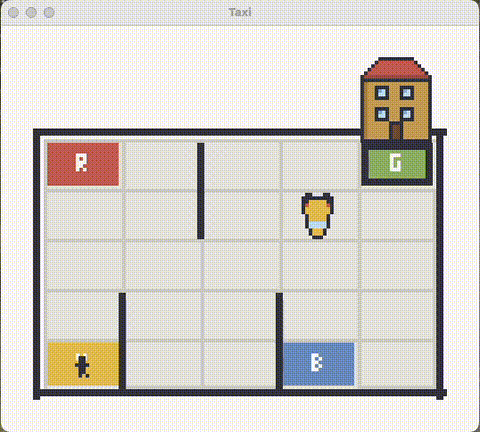

## Autonomous Taxi game

The Taxi Problem involves navigating to passengers in a grid world, picking them up and dropping them off at one of four locations.

#### Action Space

The action shape is (1,) in the range {0, 5} indicating which direction to move the taxi or to pickup/drop off passengers.

0: Move south (down)
1: Move north (up)
2: Move east (right)
3: Move west (left)
4: Pickup passenger
5: Drop off passenger

